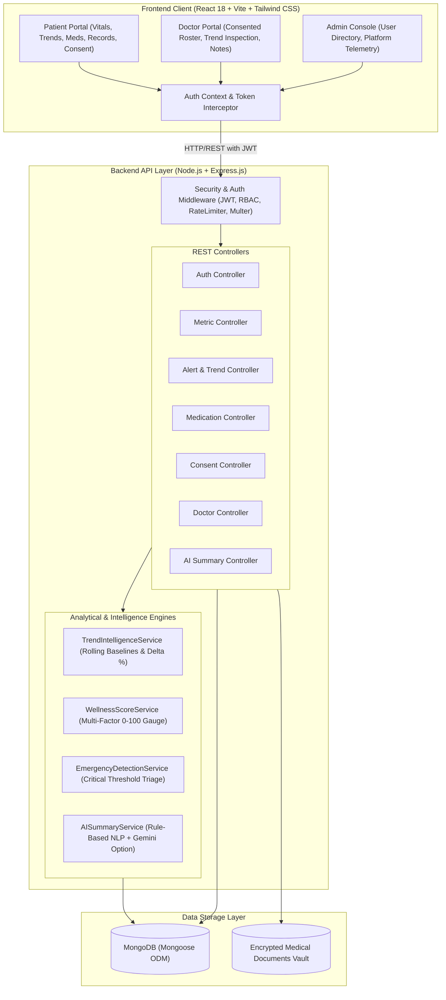

# CareSync: Comprehensive Technical Project Report

**Project Title:** CareSync – Intelligent Preventive Healthcare & Patient Monitoring Platform  
**Target Audience:** Final-Year Computer Science & Engineering (CSE) Capstone / Campus Placement Interview Defense  
**Domain:** Full-Stack Web Development, Health Informatics, Explainable Algorithmic Analytics, Applied AI  

---

## 1. Problem Statement
Modern healthcare ecosystems remain largely **reactive**. Patients consult physicians only when symptoms become acute, debilitating, or emergency-grade. Between intermittent clinical appointments, there exists a complete data blackout regarding a patient's daily physiological parameters, medication compliance, and emerging symptoms.

Furthermore, traditional patient-tracking apps rely on crude static thresholds (e.g., alert only if systolic BP > 140 mmHg). Consequently, they fail to detect subtle, gradual physiological changes—such as a continuous 15% increase in resting heart rate or blood pressure over several days—that signal impending decompensation.

---

## 2. Existing System vs. CareSync Proposed System

### Limitations of Existing Systems
1. **Static Threshold Blindness:** Binary threshold checks trigger false alarms or fail to notice insidious upward/downward trends within the "normal" range.
2. **Siloed Data Reservoirs:** Patients keep fragmented records across paper notebooks, fitness trackers, and scattered clinic printouts.
3. **Black-Box AI Diagnoses:** Many modern prototypes attempt to predict illnesses using unverified machine learning models, creating liability risks and confusing patients with unexplainable probability scores.
4. **All-or-Nothing Sharing:** Patients are often forced to either give total unvetted record access or zero access to healthcare providers.
5. **Lack of Doctor Preparation:** Doctor consultations are rushed because physicians lack an executive summary of the patient's daily compliance and vital trends between visits.

### CareSync Proposed Innovations
1. **Explainable Health Trend Intelligence:** Analyzes multi-day rolling baselines (e.g., earlier 7-day average vs. recent 3-day average) to detect trajectory shifts, providing clear transparent reasoning without claiming diagnostic capability.
2. **Non-Diagnostic Holistic Wellness Score (0–100):** Synthesizes sleep quality, resting vitals, medication adherence, and symptom load into an actionable, non-diagnostic lifestyle wellness index.
3. **Sovereign Consent Ledger:** A granular access-control matrix where patients explicitly choose which modules (vitals, meds, symptoms, files) a specific doctor may view, with one-click revocation.
4. **Clinical AI Health Briefing Assistant:** Translates raw vitals, adherence logs, and symptoms into a concise clinical briefing equipped with 4–5 focused questions to ask the doctor.
5. **Emergency Triage Warning Mechanism:** Automatically scans newly recorded metrics for critical emergency thresholds (e.g., hypertensive crisis BP ≥ 180/120, SpO2 ≤ 88%) and delivers immediate guidance to contact emergency services.

---

## 3. System Architecture



---

## 4. Database Schema & Collections Design

The MongoDB database is structured using 12 specialized Mongoose collections designed to ensure 3NF equivalent data separation while exploiting document embedding where beneficial:

### 1. `User` Collection
- **Purpose:** Centralized identity and role management.
- **Fields:** `name`, `email` (unique index), `password` (hashed with bcrypt), `role` (`patient`, `doctor`, `admin`), `phone`, `avatar`, `isActive`, `lastLogin`.
- **Indexing:** `{ email: 1 }`, `{ role: 1 }`.

### 2. `PatientProfile` Collection
- **Purpose:** Personal clinical baseline and emergency demographics.
- **Fields:** `user` (ObjectId ref User), `dateOfBirth`, `gender`, `bloodGroup`, `heightCm`, `weightKg`, `emergencyContact: { name, relationship, phone }`, `allergies: [String]`, `chronicConditions: [String]`, `pastSurgeries: [String]`, `lifestyleHabits: { smoking, alcohol, exerciseFrequency, dietType }`.

### 3. `DoctorProfile` Collection
- **Purpose:** Clinical credentials and accreditation metadata.
- **Fields:** `user` (ObjectId ref User), `specialization`, `licenseNumber`, `experienceYears`, `hospitalAffiliation`, `qualifications: [String]`, `bio`, `isVerified`.

### 4. `HealthMetric` Collection
- **Purpose:** High-frequency vital telemetry logs.
- **Fields:** `patient` (ObjectId ref User), `recordedAt`, `systolicBP`, `diastolicBP`, `heartRate`, `spO2`, `bloodGlucose`, `bloodGlucoseType`, `temperature`, `weight`, `sleepHours`, `sleepQuality`, `notes`, `source`.
- **Compound Index:** `{ patient: 1, recordedAt: -1 }` (optimizes chronological trend queries).

### 5. `Symptom` Collection
- **Purpose:** Subjective symptom journal and severity tracking.
- **Fields:** `patient`, `symptomName`, `severity` (1–10), `duration`, `onsetDate`, `bodyLocation`, `notes`, `status` (`active`, `improving`, `worsening`, `resolved`), `triggers: [String]`.

### 6. `Medication` Collection
- **Purpose:** Active prescription regimens.
- **Fields:** `patient`, `name`, `dosage`, `frequency`, `route`, `purpose`, `instructions`, `startDate`, `endDate`, `reminderTimes: [String]`, `prescriberName`, `isActive`.

### 7. `MedicationLog` Collection
- **Purpose:** Granular dose-taking events for adherence calculation.
- **Fields:** `medication`, `patient`, `scheduledDate` (YYYY-MM-DD), `scheduledTime`, `status` (`taken`, `missed`, `skipped`), `actionTime`, `notes`.
- **Compound Index:** `{ medication: 1, scheduledDate: 1, scheduledTime: 1 }`.

### 8. `MedicalRecord` Collection
- **Purpose:** Metadata and disk references for uploaded lab and scan files.
- **Fields:** `patient`, `title`, `documentType` (`prescription`, `lab_report`, `scan_report`, etc.), `originalFilename`, `filePath`, `fileSize`, `mimeType`, `uploadDate`, `description`, `tags: [String]`, `issuingDoctorOrClinic`.

### 9. `Alert` Collection
- **Purpose:** Persists explainable trend warnings and emergency notices.
- **Fields:** `patient`, `type` (`trend_warning`, `threshold_breach`, `emergency_advisory`), `severity` (`info`, `warning`, `critical`), `title`, `message`, `reason` (Explainable text), `metric`, `metricsAnalyzed`, `isRead`, `isDismissed`, `generatedAt`.

### 10. `DoctorNote` Collection
- **Purpose:** Formal clinical observations and guidance entered by doctors.
- **Fields:** `doctor`, `patient`, `title`, `observation`, `generalGuidance`, `recommendedTests: [String]`, `followUpDate`, `isSharedWithPatient`.

### 11. `Consent` Collection
- **Purpose:** Patient-granted access permissions ledger.
- **Fields:** `patient`, `doctor`, `status` (`active`, `revoked`, `expired`), `permissions: { shareVitals, shareMedications, shareSymptoms, shareMedicalRecords, shareDoctorNotes }`, `grantedAt`, `revokedAt`, `expiresAt`, `notes`.
- **Compound Index:** `{ patient: 1, doctor: 1 }`.

### 12. `Notification` Collection
- **Purpose:** In-app operational alerts and reminders.
- **Fields:** `user`, `title`, `message`, `type`, `link`, `isRead`, `createdAt`.

---

## 5. Algorithmic Detail: Health Trend Intelligence

The core innovation of CareSync is its rolling baseline trajectory algorithm implemented in `src/services/trendIntelligenceService.js`:

```javascript
// Mathematical formulation of rolling baseline comparison:
// Let M = [m_1, m_2, ..., m_n] be chronological metrics over a 14-day window.
// Baseline set B = { m_1, ..., m_{n/2} }
// Recent set R = { m_{n/2 + 1}, ..., m_n }

avg_baseline = (1 / |B|) * SUM(m_i)
avg_recent   = (1 / |R|) * SUM(m_j)

delta_percent = ((avg_recent - avg_baseline) / avg_baseline) * 100

// If delta_percent >= 8% AND avg_recent > 125 mmHg:
// -> Trigger Explainable Upward BP Alert
```

**Why this matters in a CSE evaluation:**  
Unlike black-box neural networks that cannot explain their internal activation weights, CareSync produces a deterministic, mathematically verifiable explanation:  
*"Your average systolic reading increased by approximately 16.0% (from 119 mmHg to 138 mmHg) across recent readings."*  
This explainability satisfies clinical transparency guidelines and avoids hallucination.

---

## 6. Healthcare Security & Privacy Implementation

1. **Password Encryption:** Passwords are cryptographically salted and hashed using `bcryptjs` with 10 rounds of work factor before ever touching storage.
2. **Stateless JWT Authorization:** API requests carry `Bearer <token>` headers validated via middleware. Expired or tampered signatures result in immediate `401 Unauthorized` responses.
3. **Role-Based Access Control (RBAC):** Middleware checks `req.user.role` against authorized role arrays for each protected endpoint.
4. **Prevention of Insecure Direct Object Reference (IDOR):**
   - In document downloads (`/api/records/:id/download`), the server verifies whether `req.user.id == record.patient`.
   - If a doctor requests the file, the server queries the `Consent` collection to verify an active consent record with `shareMedicalRecords: true`.
5. **Secure File Sanitization:** Multer enforces randomized filenames (`record-1731435000000.pdf`), strict extension allowlists (`pdf|jpg|png|doc|docx`), and a 10MB maximum payload limit.
6. **Denial-of-Service Defense:** Implemented `express-rate-limit` (300 requests/15min for general APIs, 30 requests/15min for auth endpoints).

