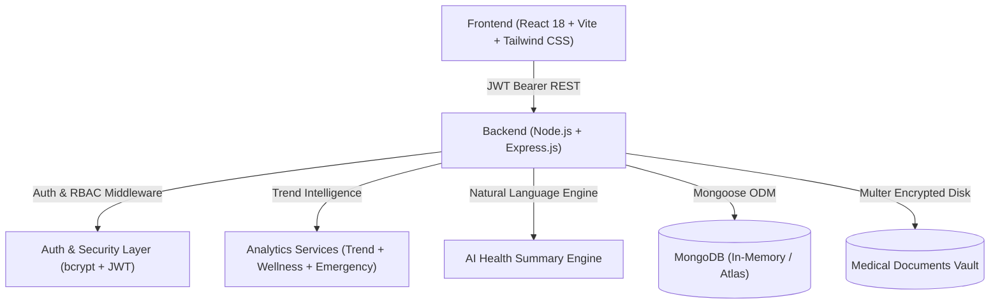

# CareSync – Intelligent Preventive Healthcare & Patient Monitoring Platform

[](https://reactjs.org/)
[](https://nodejs.org/)
[](https://www.mongodb.com/)
[](https://tailwindcss.com/)
[](LICENSE)

> **CareSync** is a full-stack, enterprise-grade preventive healthcare platform engineered to bridge the critical gap between daily patient self-monitoring and clinical physician oversight. Instead of merely triggering alarms on static boundary thresholds, CareSync incorporates **Health Trend Intelligence**—an explainable algorithmic engine that identifies gradual multi-day physiological shifts before they escalate into acute medical episodes.

---

## 🌟 Key Innovations & Features

### 1. 📈 Health Trend Intelligence Engine
- **Trajectory Analysis over Threshold Checking:** Analyzes rolling baseline averages vs. recent readings (7 to 30 days) for Blood Pressure, Resting Heart Rate, Oxygen Saturation (SpO2), Blood Glucose, and Sleep.
- **Explainable Reasoning:** Explains transparently *why* an alert fired (e.g., *"Your average systolic reading increased by approximately 16.0% (from 119 mmHg to 138 mmHg) across recent readings"*).
- **Strictly Non-Diagnostic:** Directs user awareness toward timely lifestyle adjustments and doctor consultations without claiming disease diagnosis.

### 2. 🛡️ Non-Diagnostic Wellness Score (0–100)
- Holistic composite indicator synthesizing:
  - Sleep duration & restorative consistency (Max 20 pts)
  - Resting heart rate stability (Max 20 pts)
  - Blood pressure variance & stage bounds (Max 20 pts)
  - Medication adherence percentage (Max 20 pts)
  - Symptom burden & severity impact (Max 10 pts)
  - Blood oxygen & vital equilibrium (Max 10 pts)
- Color-coded circular gauge with personalized preventive recommendations.

### 3. 💊 Medication Management & Compliance Analytics
- Prescription registry: Name, dosage, frequency, administration route, reminder times.
- Daily digital dose log: Mark doses as `Taken`, `Missed`, or `Skipped`.
- Compliance analytics: 14-day stacked bar charts evaluating percentage adherence.

### 4. 📝 Symptom Journal & Timeline
- Multi-parameter logging: Symptom name, severity scale (1–10), duration, onset date/time, body location, triggers, and notes.
- **Algorithmic Pattern Recognition:** Detects recurring symptom clusters over rolling windows.

### 5. 📂 Encrypted Medical Records Vault
- Secure document uploading with Multer: Lab blood panels, prescriptions, scan reports, medical certificates, and discharge summaries.
- Role-based download authorization: Only accessible by the patient or explicitly authorized doctors.

### 6. 🤝 Sovereign Doctor-Patient Data Sharing (Consent Ledger)
- Fine-grained consent authorization: Patients select a doctor and choose exact permissions:
  - `shareVitals`
  - `shareMedications`
  - `shareSymptoms`
  - `shareMedicalRecords`
  - `shareDoctorNotes`
- **Instantaneous Revocation:** Patients can terminate doctor access at any time.

### 7. 🩺 Doctor Tele-Monitoring Portal
- Roster of consented patients with real-time vital cards and active alert counters.
- Longitudinal trend inspection with interactive Recharts.
- Clinical observation recording: Add guidance, lifestyle modifications, recommended lab tests, and follow-up schedules.

### 8. 🤖 AI Preventive Health Assistant
- Synthesizes multi-stream health data into an actionable briefing:
  - Executive summary of recent vitals
  - Observed trend explanations
  - Medication compliance evaluation
  - **4–5 high-value questions tailored for the patient to ask their doctor!**
- Operates via a robust, rule-based clinical NLP engine out of the box (with optional Google Gemini 1.5 API integration).

### 9. 🚨 Emergency Vital Advisory & Triage
- Immediate detection of acute physiological thresholds (e.g. Hypertensive crisis BP ≥180/120, SpO2 ≤88%, extreme tachycardia/bradycardia).
- Renders high-priority emergency banners directing users to emergency services (911 / 112 / 108).

---

## 🏗️ Architecture & Tech Stack



| Layer | Technologies |
| :--- | :--- |
| **Frontend** | React 18, Vite, Tailwind CSS, Lucide React, Recharts, React Router v6, Axios |
| **Backend** | Node.js (v24/v20/v18), Express.js, JWT, bcryptjs, Multer, Express-Validator, Morgan |
| **Database** | MongoDB with Mongoose ODM (includes embedded MongoMemoryServer for zero-config demo) |
| **Security** | Rate Limiting (`express-rate-limit`), CORS, RBAC Middleware, File Sanitization |

---

## 🚀 Quick Start (1-Click Execution)

CareSync is equipped with an **embedded in-memory MongoDB fallback** and **auto-seeding**, meaning it runs out-of-the-box on any machine without needing local MongoDB installed!

### Option A: Windows 1-Click Batch Script
Double-click `start-caresync.bat` in the root folder, or run in terminal:
```powershell
.\start-caresync.bat
```
*(Automatically starts Backend on port 5000, Frontend on port 5173, seeds demo data, and opens your browser!)*

### Option B: Manual Startup

#### 1. Backend Setup
```bash
cd backend
npm install
npm run seed     # (Optional: Seeds demo data if database is empty)
npm start        # Starts server on http://localhost:5000
```

#### 2. Frontend Setup
```bash
cd ../frontend
npm install
npm run dev      # Starts Vite on http://localhost:5173
```

---

## 🔑 Pre-Seeded Placement Demo Credentials

| Role | Email Address | Password | Clinical Case Demonstrated |
| :--- | :--- | :--- | :--- |
| **🧑 Patient** | `john@caresync.health` | `Password123!` | **Upward Systolic BP Trend (+16%) Alert**, 14-day medication logs, active consent granted to Dr. Chen |
| **👩 Patient** | `sarah@caresync.health` | `Password123!` | Normal stable vitals, asthma monitoring |
| **👩‍⚕️ Doctor** | `dr.chen@caresync.health` | `Password123!` | Cardiologist reviewing John Doe's telemetry and documenting observations |
| **👨‍⚕️ Doctor** | `dr.vance@caresync.health` | `Password123!` | Internal Medicine specialist |
| **👨‍💼 Admin** | `admin@caresync.health` | `AdminPassword123!` | Global user directory, security audits, platform metrics |

*(Note: The login page includes 1-click quick fill buttons for instant demonstration!)*

---

## 📡 REST API Documentation

### Authentication (`/api/auth`)
| Method | Endpoint | Access | Description |
| :--- | :--- | :--- | :--- |
| `POST` | `/api/auth/register` | Public | Register new patient or doctor account |
| `POST` | `/api/auth/login` | Public | Authenticate user, returns JWT and user payload |
| `GET` | `/api/auth/me` | Private | Retrieve active session profile |
| `PUT` | `/api/auth/profile` | Private | Update user contact details |

### Health Metrics & Telemetry (`/api/health-metrics`)
| Method | Endpoint | Access | Description |
| :--- | :--- | :--- | :--- |
| `POST` | `/api/health-metrics` | Private | Log vitals; runs emergency detection & trend engine |
| `GET` | `/api/health-metrics` | Private | Query vitals with range filters (`range=7,30,90,all`) |
| `GET` | `/api/health-metrics/summary` | Private | Aggregated averages and latest reading |
| `DELETE`| `/api/health-metrics/:id` | Private | Delete specific vital entry |

### Intelligent Alerts & Trends (`/api/alerts`)
| Method | Endpoint | Access | Description |
| :--- | :--- | :--- | :--- |
| `GET` | `/api/alerts` | Private | Fetch explainable trend alerts |
| `PUT` | `/api/alerts/:id/read` | Private | Mark alert as read |
| `PUT` | `/api/alerts/:id/dismiss`| Private | Dismiss alert |
| `POST`| `/api/alerts/run-analysis`| Private| Manually trigger Trend Intelligence scan |

### Sovereign Consent Ledger (`/api/consent`)
| Method | Endpoint | Access | Description |
| :--- | :--- | :--- | :--- |
| `POST` | `/api/consent` | Patient | Grant granular data sharing permissions to doctor |
| `GET` | `/api/consent` | Patient | View active consents and authorization history |
| `PUT` | `/api/consent/:id/revoke` | Patient | Revoke doctor access immediately |
| `PUT` | `/api/consent/:id/permissions` | Patient | Update granular permission flags |

### Doctor Portal (`/api/doctor`)
| Method | Endpoint | Access | Description |
| :--- | :--- | :--- | :--- |
| `GET` | `/api/doctor/dashboard` | Doctor | Active patients, alerts feed, observations |
| `GET` | `/api/doctor/patients` | Doctor | Consented patients list with latest metrics |
| `GET` | `/api/doctor/patients/:id`| Doctor | Deep telemetry inspection (enforces consent) |
| `POST`| `/api/doctor/notes` | Doctor | Document clinical observations and guidance |

### AI Health Briefing (`/api/ai`)
| Method | Endpoint | Access | Description |
| :--- | :--- | :--- | :--- |
| `GET` | `/api/ai/health-summary` | Private | Generate structured briefing with doctor discussion prompts |

---

## 🧪 Automated Testing

CareSync includes an automated test runner validating the trend intelligence algorithm, wellness scoring, and authentication security:
```bash
cd backend
npm test
```

Expected output:
```
========================================================
🔬 CareSync Comprehensive Automated Test Runner
========================================================
🧪 Testing Authentication, Password Hashing & JWT Security...
   ✅ Bcrypt Password Hashing & Verification: Passed.
   ✅ JWT Generation & Cryptographic Verification: Passed.
   ✅ Tampered JWT Signature Rejection: Passed.

🧪 Testing Wellness Score Component Calculation...
   ✅ Ideal Health Profile Score: 100/100 (Optimal)
   ✅ Moderate Health Profile Score: 77/100 (Moderate)
   ✅ Elevated Burden Profile Score: 51/100 (Needs Attention)

🧪 Testing Trend Intelligence Algorithm...
   ✅ Systolic Trend Calculation: +18.1% delta correctly identified.
   ✅ Heart Rate Trend Calculation: +24.6% increase correctly detected.
   ✅ SpO2 Dip Detection: Average 93.0% below threshold correctly recognized.
========================================================
📋 Test Results: 3 Passed, 0 Failed
🎉 ALL CARESYNC UNIT & INTEGRATION TESTS PASSED!
========================================================
```

---

## 🌐 Production Deployment Guide

### Database (MongoDB Atlas)
1. Create a free cluster on [MongoDB Atlas](https://www.mongodb.com/cloud/atlas).
2. Obtain connection string: `mongodb+srv://<user>:<password>@cluster.mongodb.net/caresync`.
3. Set in backend environment: `USE_IN_MEMORY_DB=false` and `MONGO_URI=<your-connection-string>`.

### Backend (Render / Railway)
1. Push repository to GitHub.
2. Link repository to Render or Railway as a Web Service.
3. Set Root Directory: `backend`.
4. Build Command: `npm install`.
5. Start Command: `npm start`.
6. Environment Variables:
   - `PORT=5000`
   - `MONGO_URI=<atlas_uri>`
   - `USE_IN_MEMORY_DB=false`
   - `JWT_SECRET=<strong_secret_key>`
   - `CLIENT_URL=https://your-frontend.vercel.app`

### Frontend (Vercel)
1. Link repository to Vercel.
2. Root Directory: `frontend`.
3. Build Command: `npm run build`.
4. Output Directory: `dist`.
5. Environment Variable:
   - `VITE_API_URL=https://your-backend.onrender.com/api`

---

## 📜 Medical & Educational Disclaimer
CareSync is an educational computer science capstone project designed to showcase preventive healthcare workflows, sovereign data sharing, and trend intelligence algorithms. It is strictly **non-diagnostic**, does not prescribe medications, and is not a substitute for licensed medical judgment.

